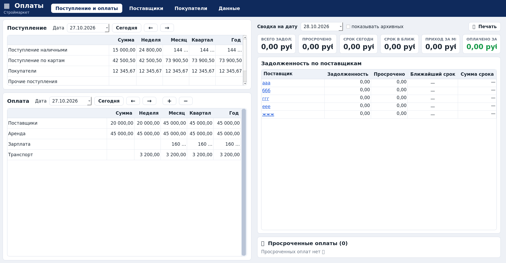

# Оплаты — Строймаркет

Настольная программа под **Windows** для учёта оплат поставщикам и покупателям:
сводка задолженности, экран «Поступление и оплаты», недельные таблицы
поставщиков «Приход / Долг / Оплата» и покупателей «Реализация / Оплата»,
календарь рабочих дней. Интерфейс — по макетам в `docs/mockups/`.

> **Статус: v0.13.0 — квартал, журналы строк, плашка «Оплата» до низа
> поставщиков, таблицы «Поступление» и «Оплата» с нарастающими итогами,
> печать «Сводки» и настраиваемый рабочий календарь; Windows-сборка
> основным вариантом идёт папкой.**
> В шапке порядок вкладок: «Поступление и оплаты», «Поставщики»,
> «Покупатели», «Данные»; вкладок «Сводка» и «Операции» нет — «Сводка»
> стоит **панелью справа** на первой вкладке. На вкладке
> «Поступление и оплаты» блок **«Оплата» стоит под блоком
> «Поступление»**; заголовок блока и строка даты (поле с календарём,
> «Сегодня», стрелки «←»/«→») идут в одну строчку. Ниже таблица: строки
> «Поступление наличными», «Поступление по картам», «Покупатели» и
> столбцы «Сумма / Неделя / Месяц / Год», где Неделя, Месяц и Год —
> нарастающий итог с начала периода по выбранную дату. Наличные и карты
> вводятся прямо в ячейку; клик по строке «Покупатели» (или
> «Поставщики») открывает окно **справа** со списком контрагентов и
> полями сумм, в котором сразу виден итог по всем покупателям. Журнал
> операций открывается отдельным окном из карточки контрагента. Суммы
> вводятся прямо в
> ячейках: у поставщика «Приход» считает срок оплаты и ставит сумму в
> архивный «Долг», у покупателя «Реализация» срока не имеет. Клик по
> поставщику открывает «Поставку», клик по покупателю — окно
> «Реализация» без поля срока. Во вкладке «Данные» две раскрывающиеся
> плашки: «Настройка календаря» (выходные — красные, рабочие переносы —
> серые, применяется кнопкой «Сохранить») и «Администрирование». В
> недельных таблицах выходные и праздники розовые; у текущей даты
> салатовой остаётся только верхняя ячейка вида «27 вт», остальные ячейки
> дня не красятся. Кнопки «Карточка поставщика» / «Карточка покупателя»
> живут в панели недельной таблицы, слева от «Очистить суммы». Суммы
> покупателей и поставщиков, введённые в блоках, видны и в недельных
> таблицах — и наоборот. **Свои строки** добавляются кнопками «+» и «−»
> **в заголовке блока «Оплата»** (прочие виды оплат); в блоке
> «Поступление» под строкой «Покупатели» стоит постоянная строка
> **«Прочие поступления»**. Клик по названию строки открывает **журнал**
> этой строки — поступлений или оплат. Итоги считаются нарастанием:
> **Неделя (Пн–Вс), Месяц, Квартал, Год**. Суммы в окне
> контрагентов сохраняются по клику вне полей ввода (кнопок
> «Закрыть»/«Сохранить» нет), ячейки во всех таблицах становятся
> полями ввода по одному клику, числа выровнены по правому краю, под
> курсором бежевым подсвечивается вся строка, шрифты интерфейса на 30%
> больше. В таблице «Покупатели» клик по покупателю показывает его
> журнал операций. Пока заглушки: цифры «Сводки» и
> долг покупателей.



## Скачать готовую программу (Windows)

1. GitHub → вкладка **Actions** → последний зелёный запуск **Build Windows**.
2. В блоке **Artifacts** скачайте **`Oplata-windows-folder-v…`**
   (рекомендуемый вариант) → распаковать всю папку → запускать
   `Oplata\Oplata.exe`. Не вытаскивайте EXE из папки отдельно — рядом лежат
   нужные DLL; на рабочий стол можно вынести ярлык.
3. Если нужен именно один файл, запасной
   `Oplata-windows-single-file-v…` публикуется в Releases по тегам
   `v*` (в обычных запусках для ускорения собирается только folder).

Подробнее (включая блокировку загрузки браузером и SmartScreen):
[docs/BUILD.md](docs/BUILD.md).

## Экраны

| Экран | Макет пользователя | Текущий вид |
|---|---|---|
| Сводка | [01-summary.png](docs/mockups/01-summary.png) | [receipts.png](docs/screenshots/receipts.png) — панель справа |
| Печатная «Сводка» | кнопка «Печать» на макете 01 | [summary-print.png](docs/screenshots/summary-print.png) |
| Поставщики | макет из 1-го сообщения (см. SPEC §2) | [suppliers.png](docs/screenshots/suppliers.png) |
| Покупатели | [03-customers-week.png](docs/mockups/03-customers-week.png) | [customers.png](docs/screenshots/customers.png) |
| Поступление и оплаты | запрос пользователя (два блока друг под другом) | [receipts.png](docs/screenshots/receipts.png) |
| Окно покупателей (справа) | запрос пользователя (окно с суммами и итогом) | [receipts-customers-popup.png](docs/screenshots/receipts-customers-popup.png) |
| Данные | [05-data-calendar.png](docs/mockups/05-data-calendar.png) | [data.png](docs/screenshots/data.png) |
| Карточка поставщика | [06-supplier-card.png](docs/mockups/06-supplier-card.png) | [supplier-card.png](docs/screenshots/supplier-card.png) |
| Окно «Поставка» | [07-delivery-dialog.png](docs/mockups/07-delivery-dialog.png) | [delivery-dialog.png](docs/screenshots/delivery-dialog.png) |
| Окно «Реализация» | по образцу окна «Поставка» | [realization-dialog.png](docs/screenshots/realization-dialog.png) |
| Окно операции | — | [operation-dialog.png](docs/screenshots/operation-dialog.png) |

## Разработчикам и агентам

**Начинайте с [AGENTS.md](AGENTS.md)** — там правила проекта, карта кода и
команды. Документация: [SPEC](docs/SPEC.md) · [Архитектура](docs/ARCHITECTURE.md) ·
[Сборка](docs/BUILD.md) · [План и открытые вопросы](docs/ROADMAP.md) ·
[Решения (ADR)](docs/DECISIONS.md) · [Журнал изменений](CHANGELOG.md).

```bash
python -m venv .venv && .venv/bin/pip install -r requirements-dev.txt
.venv/bin/python run.py            # запуск из исходников
.venv/bin/python -m pytest -q      # тесты
```

Стек: Python 3.11+ · PySide6 (Qt) · PyInstaller → основная сборка папкой
(`Oplata\Oplata.exe` + DLL) и запасная одним файлом; обе собираются
автоматически в GitHub Actions на `windows-latest`.
Данные: `%APPDATA%\OplataStroymarket\data.json`.
