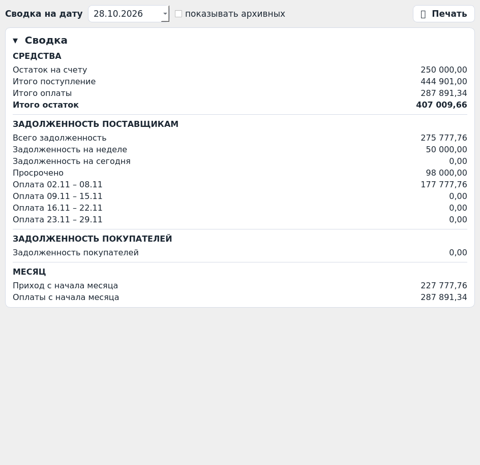

# Оплаты — Строймаркет

Настольная программа под **Windows** для учёта оплат поставщикам и покупателям:
сводка задолженности, недельные таблицы «Приход / Долг / Оплата», журнал
операций, календарь рабочих дней. Интерфейс — по макетам в `docs/mockups/`.

> **Статус: v0.5.0 — поставки, срок оплаты, долг, редактируемый журнал
> и печать «Сводки»; Windows-сборка основным вариантом идёт папкой.**
> Клик по поставщику открывает окно «Поставка» (дата, сумма с НДС):
> программа считает срок оплаты (дата + отсрочка, перенос с выходного) и
> ставит сумму в «Долг» на этот срок; работают колонки «просрочено на
> сегодня» и «задолженность за неделю». «Оплата» вводится в ячейках, а в
> журнале любую операцию можно добавить вручную, исправить с документом и
> комментарием или удалить. Кнопка «Печать» на «Сводке» открывает
> предпросмотр A4 и печатает видимый снимок экрана. Пока заглушки: цифры
> «Сводки» и долг покупателей.



## Скачать готовую программу (Windows)

1. GitHub → вкладка **Actions** → последний зелёный запуск **Build Windows**.
2. В блоке **Artifacts** скачайте **`Oplata-windows-folder-v…`**
   (рекомендуемый вариант) → распаковать всю папку → запускать
   `Oplata\Oplata.exe`. Не вытаскивайте EXE из папки отдельно — рядом лежат
   нужные DLL; на рабочий стол можно вынести ярлык.
3. Если нужен именно один файл, рядом лежит запасной артефакт
   `Oplata-windows-single-file-v…`.

Подробнее (включая блокировку загрузки браузером и SmartScreen):
[docs/BUILD.md](docs/BUILD.md).

## Экраны

| Экран | Макет пользователя | Текущий вид |
|---|---|---|
| Сводка | [01-summary.png](docs/mockups/01-summary.png) | [summary.png](docs/screenshots/summary.png) |
| Печатная «Сводка» | кнопка «Печать» на макете 01 | [summary-print.png](docs/screenshots/summary-print.png) |
| Поставщики | макет из 1-го сообщения (см. SPEC §2) | [suppliers.png](docs/screenshots/suppliers.png) |
| Покупатели | [03-customers-week.png](docs/mockups/03-customers-week.png) | [customers.png](docs/screenshots/customers.png) |
| Операции | [04-operations.png](docs/mockups/04-operations.png) | [operations.png](docs/screenshots/operations.png) |
| Данные | [05-data-calendar.png](docs/mockups/05-data-calendar.png) | [data.png](docs/screenshots/data.png) |
| Карточка поставщика | [06-supplier-card.png](docs/mockups/06-supplier-card.png) | [supplier-card.png](docs/screenshots/supplier-card.png) |
| Окно «Поставка» | [07-delivery-dialog.png](docs/mockups/07-delivery-dialog.png) | [delivery-dialog.png](docs/screenshots/delivery-dialog.png) |
| Окно операции | — | [operation-dialog.png](docs/screenshots/operation-dialog.png) |

## Разработчикам и агентам

**Начинайте с [AGENTS.md](AGENTS.md)** — там правила проекта, карта кода и
команды. Документация: [SPEC](docs/SPEC.md) · [Архитектура](docs/ARCHITECTURE.md) ·
[Сборка](docs/BUILD.md) · [План и открытые вопросы](docs/ROADMAP.md) ·
[Решения (ADR)](docs/DECISIONS.md) · [Журнал изменений](CHANGELOG.md).

```bash
python -m venv .venv && .venv/bin/pip install -r requirements-dev.txt
.venv/bin/python run.py            # запуск из исходников
.venv/bin/python -m pytest -q      # тесты
```

Стек: Python 3.11+ · PySide6 (Qt) · PyInstaller → основная сборка папкой
(`Oplata\Oplata.exe` + DLL) и запасная одним файлом; обе собираются
автоматически в GitHub Actions на `windows-latest`.
Данные: `%APPDATA%\OplataStroymarket\data.json`.
