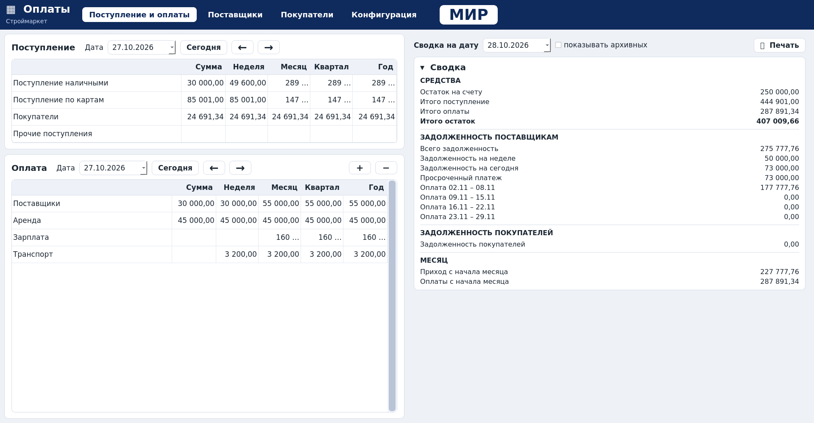

# Оплаты — Строймаркет

Настольная программа под **Windows** для учёта оплат поставщикам и покупателям:
сводка задолженности, экран «Поступление и оплаты», недельные таблицы
поставщиков «Приход / Долг / Оплата» и покупателей «Реализация / Оплата»,
календарь рабочих дней. Интерфейс — по макетам в `docs/mockups/`.

> **Статус: v0.15.0 — в «Сводке» задолженность покупателей и оплата
> понедельно на четыре недели, долги поставщиков переносятся на новые
> недели, плашка «Сводка» построчно (средства, задолженность
> поставщикам, задолженность покупателей, месяц),
> вкладка «Конфигурация» с плашкой «Данные» (разовый
> перенос остатков на 1 января: долги поставщикам с датой оплаты,
> задолженность покупателей, текущие средства на счету), стрелки блока
> «Оплата» в правом углу, квартал, плашка «Оплата» до низа
> поставщиков, таблицы «Поступление» и «Оплата» с нарастающими итогами,
> журнал движения средств за 30 дней и настраиваемый рабочий
> календарь; Windows-сборка
> основным вариантом идёт папкой.**
> В шапке порядок вкладок: «Поступление и оплаты», «Поставщики»,
> «Покупатели», «Конфигурация»; вкладок «Сводка» и «Операции» нет — «Сводка»
> стоит **панелью справа** на первой вкладке — это плашка из трёх
> блоков, все значения построчно: «Средства» (остаток на начало дня,
> поступление за день, оплаты за день, итого остаток), «Задолженность
> поставщикам» (всего, **на неделе — только долги текущей недели**,
> просроченный платёж и оплата понедельно на четыре недели вперёд;
> v0.36.0), «Задолженность покупателей»
> (Реализация − Оплата) и «Месяц» (приход и оплаты с начала месяца).
> **Столбец «Задолженность» справочный**: в расчётах денег он не
> участвует; при неполной или несвоевременной оплате поставщику остаток
> долга переносится на следующую неделю.
> **Деньги, пришедшие от покупателя (строка «Покупатели» блока
> «Поступление»), считаются поступлением** (v0.35.0): плюсом
> в «Поступление за день» и в «Итого остаток», в журнале — в графе
> «Поступление». В **«Приход с начала месяца» они не входят**
> (v0.37.0): там считается только пришедший товар — сумма операций
> «Приход».
> Сводка пересчитывается сразу после ввода любой суммы. На вкладке
> «Поступление и оплаты» блок **«Оплата» стоит под блоком
> «Поступление»**; заголовок блока и строка даты (поле с календарём,
> «Сегодня», стрелки «←»/«→») идут в одну строчку. Ниже таблица: строки
> «Поступление наличными», «Поступление по картам», «Покупатели» и
> шесть колонок дней текущей недели (Пн–Сб) с суммой за каждый день;
> **v0.38.0: отдельной колонки «Сумма» больше нет** — сумма вводится
> прямо в ячейку своего дня. Стрелки «←»/«→» листают **недели**
> (и кнопки в шапке блока, и клавиши в таблице). В блоке «Оплата»
> вторым столбцом стоит «НДС» —
> ставка вида из его карточки (v0.33.0). Наличные и карты
> вводятся прямо в ячейку; клик по строке «Покупатели» (или
> «Поставщики») открывает окно **справа** со списком контрагентов и
> полями сумм, в котором сразу виден итог по всем покупателям. Окно
> открывается **на дату нажатой ячейки дня** (v0.39.0): сумма попадает
> именно в неё. Журнал
> операций открывается отдельным окном из карточки контрагента. Суммы
> вводятся прямо в
> ячейках: у поставщика «Приход» считает срок оплаты и ставит сумму в
> архивный «Долг», у покупателя «Реализация» срока не имеет. Клик по
> поставщику открывает «Поставку», клик по покупателю — окно
> «Реализация» без поля срока. Во вкладке **«Конфигурация»** (прежнее
> имя — «Данные») три
> раскрывающиеся плашки: «Настройка календаря» (выходные — красные,
> рабочие переносы — серые, применяется кнопкой «Сохранить»),
> **«Данные»** — разовый перенос остатков на **1 января**: поставщики
> (дата оплаты и сумма), покупатели (задолженность) и отдельное поле
> «Текущие средства на счету», всё сохраняется кнопкой «Сохранить»
> (к этим цифрам формул нет) — и «Администрирование». В
> недельных таблицах выходные и праздники персиковые; **текущий день
> красится на всю высоту**, а не только шапка (v0.38.0). Кнопки «Карточка поставщика» / «Карточка покупателя»
> живут в панели недельной таблицы, рядом с «Задолженность за неделю».
> Кнопка «Очистить суммы» убрана в v0.23.1. Суммы
> покупателей и поставщиков, введённые в блоках, видны и в недельных
> таблицах — и наоборот. **Свои строки** добавляются кнопками «+» и «−»
> **в заголовке блока «Оплата»** (прочие виды оплат); в блоке
> «Поступление» под строкой «Покупатели» стоит постоянная строка
> **«Прочие поступления»**. Журналы строк убраны (v0.14.0): правка идёт
> в ячейках; **стрелки «←»/«→» блока «Оплата» стоят в правом углу**, а
> в блоке «Поступление» **скроллинга нет**. Итоги считаются нарастанием:
> **Неделя (Пн–Вс), Месяц, Квартал, Год**. Суммы в окне
> контрагентов сохраняются по клику вне полей ввода (кнопок
> «Закрыть»/«Сохранить» нет), ячейки во всех таблицах становятся
> полями ввода по одному клику, числа выровнены по правому краю, под
> курсором бежевым подсвечивается вся строка, в таблице поставщиков
> «ПРОСРОЧЕН.» и «ЗАДОЛЖ.» — раздельные ячейки, шрифты интерфейса на 30%
> больше. В таблице «Покупатели» клик по покупателю показывает его
> журнал операций. Пока заглушки: цифры «Сводки» и
> долг покупателей.



## Скачать готовую программу (Windows)

1. GitHub → вкладка **Actions** → последний зелёный запуск **Build Windows**.
2. В блоке **Artifacts** скачайте **`Oplata-windows-folder-v…`**
   (рекомендуемый вариант) → распаковать всю папку → запускать
   `Oplata\Oplata.exe`. Не вытаскивайте EXE из папки отдельно — рядом лежат
   нужные DLL; на рабочий стол можно вынести ярлык.
3. Если нужен именно один файл, запасной
   `Oplata-windows-single-file-v…` публикуется в Releases по тегам
   `v*` (в обычных запусках для ускорения собирается только folder).

Подробнее (включая блокировку загрузки браузером и SmartScreen):
[docs/BUILD.md](docs/BUILD.md).

## Выгрузка и загрузка базы (Excel)

В шапке, справа от переключателя **МИР/КОРЕЛИЧИ**, две кнопки —
**«Выгрузить базы»** и **«Загрузить базы»**. Они видны только
администратору.

- Куда выгружается: в папку **`Оплата база` рядом с программой**
  (v0.30.0) — там же лежат файлы самой программы, копия всегда под
  рукой. Имя файла — `Оплата ДД.ММ.ГГГГ.xlsx`, за один день файл
  перезаписывается, поэтому в папке лежит ровно одна выгрузка за день.
  Папку можно открыть в проводнике или перенести её копию на флешку:
  с данными Google Диска она не связана и является обычной копией.
- **При закрытии программы обе базы выгружаются сами** (v0.30.0),
  без вопросов и без кнопок. Если выгрузить не удалось (например, файл
  уже открыт в Excel), программа покажет предупреждение, но закроется:
  выгрузить базы вручную можно кнопкой «Выгрузить базы». Встроенного
  автозапуска при старте нет — иначе копия затёрла бы ещё не
  выгруженный ввод.
- Одним нажатием выгружаются **обе базы сразу** (МИР и КОРЕЛИЧИ) в один
  файл: листы называются «МИР. Поставщики», «МИР. Операции»,
  «КОРЕЛИЧИ. Поставщики» и так далее.
- Кнопка **«Загрузить базы»** сразу открывает папку `Оплата база` и
  подставляет самый свежий файл выгрузки (v0.30.0) — искать его по
  всему компьютеру не нужно.
- Файл открывается в Excel, правится руками и загружается обратно.
  Даты — в виде `ГГГГ-ММ-ДД`, суммы — числом, признаки
  («Предоплата», «В архиве») — словами «да»/«нет».
- Перед загрузкой программа показывает, сколько записей в каждой базе
  файла (пустая база помечается словом «пусто»), и спрашивает
  подтверждение: загрузка **заменяет** данные баз, отменить её нельзя.
- Пользователи и пароль в выгрузку не входят — это настройки доступа,
  а не данные учёта.

## Синхронизация между компьютерами (Google Диск)

Данные программы — это один файл на базу, поэтому несколько
компьютеров работают с общей базой через **общую папку Google Диска**:
файлы кладутся в неё, а программа на каждом компьютере открывает их
там. Специального режима «сервер» в программе нет.

**Как направить программу в папку Google Диска.** В готовой сборке
для Windows рядом с программой лежит файл `Start-With-Google-Drive.bat`
— запускайте программу им, а не `Oplata.exe` напрямую. Он сам находит
папку Google Диска (стандартные расположения), создаёт в ней подпапку
`Oplata` и передаёт программе путь к ней через переменную
`OPLATA_DATA_DIR`. Кроме того, этот файл сам создаёт ярлык **«Оплаты»**
(v0.30.0) с иконкой программы — рядом с программой и на рабочий стол —
и этот ярлык и есть правильный способ запускать программу каждый день.
Ярлык ведёт на bat-файл, а не на `Oplata.exe`: именно bat подключает
общую папку. Если PowerShell недоступен или запрещён, ярлык просто не
создаётся, а программа всё равно запускается.

Если папка Диска стоит нестандартно, откройте этот файл в Блокноте и
уберите `rem` в начале строки:

```bat
rem set "OPLATA_DATA_DIR=C:\Users\Имя\Google Диск\Oplata"
```

Путь должен вести в одну и ту же папку на всех компьютерах — то есть
Google Диск подключён к одному аккаунту и занимает одинаковый путь.

**Что лежит в этом каталоге и уходит в синхронизацию:**

| файл | что в нём | нужен ли общий |
|---|---|---|
| `data.json` | база **МИР** (поставщики, покупатели, операции, кассы, календарь) | да |
| `data-korelichi.json` | база **КОРЕЛИЧИ** | да |
| `users.json` | пользователи и их права | да |
| `state.json` | какая база была активна при последнем запуске | общий, см. ниже |

**Кто меняет данные, а кто только смотрит.** Схема, под которую всё
сделано: **данные меняет один компьютер — администратора**, остальные
три работают в просмотре. Права задаются пользователем, выбранным на
компьютере: «Администратор» может вводить данные, «Руководитель» и
«Пользователь …» — только смотрят (кнопки «+»/«−» скрыты, ввод в
ячейки закрыт).

Выбор пользователя хранится **в каталоге настроек самого компьютера**
(`%APPDATA%\OplataStroymarket\current-user.json`), а не в общей
папке: иначе выбор администратора на одном компьютере дал бы право
записи и на остальных. Список пользователей и пароль — наоборот,
общие (`users.json` в папке Диска).

**Как компьютеры в просмотре видят изменения.** Программа раз в
10 секунд сверяет файл данных и, если его обновил другой компьютер,
перечитывает его и обновляет экраны — перезапускать программу не
нужно. Пока открыт какой-нибудь диалог, обновление откладывается,
чтобы не сбросить незаконченный ввод.

**О чём стоит помнить.**

- `state.json` общий: переключение базы (МИР ⇄ КОРЕЛИЧИ) на одном
  компьютере переключит её и на остальных при следующем запуске.
- Программа сохраняет файл целиком при каждом изменении: ни блокировок,
  ни слияния правок нет. Если два компьютера сохранят базу
  одновременно, Google Диск создаст копию вида «data (1).json» —
  программа её не читает, и часть правок окажется в копии. Работать
  лучше по очереди, дожидаясь, пока значок Диска покажет, что файл
  синхронизирован.

## Экраны

| Экран | Макет пользователя | Текущий вид |
|---|---|---|
| Сводка | [01-summary.png](docs/mockups/01-summary.png) | [summary.png](docs/screenshots/summary.png) — плашка справа, три блока построчно |
| Журнал движения средств | запрос пользователя (v0.23.0) | [funds-movement.png](docs/screenshots/funds-movement.png) — кнопка **внизу панели «Сводка»** (v0.33.0, раньше — в шапке), за один день (v0.23.1) |
| Сводка оплат | запрос пользователя (v0.31.0) | кнопка **«Сводка оплат»** внизу панели «Сводка» (вторая из трёх, v0.33.0): виды оплат, колонка **«НДС»** (v0.34.0), 12 месяцев, кварталы и **«Год»**; год выбирается в окне, кнопка-переключатель **«Без НДС»** показывает суммы за минусом НДС |
| Сводка поступлений | запрос пользователя (v0.32.0) | кнопка **«Сводка поступлений»** там же, выше кнопки оплат: четыре строки блока «Поступление» (наличные, карты, покупатели, прочие поступления) — 12 месяцев, кварталы и **«Год»**; колонки «НДС» здесь нет |
| Поставщики | макет из 1-го сообщения (см. SPEC §2) | [suppliers.png](docs/screenshots/suppliers.png) |
| Покупатели | [03-customers-week.png](docs/mockups/03-customers-week.png) | [customers.png](docs/screenshots/customers.png) |
| Поступление и оплаты | запрос пользователя (два блока друг под другом) | [receipts.png](docs/screenshots/receipts.png) |
| Окно покупателей (справа) | запрос пользователя (окно с суммами и итогом) | [receipts-customers-popup.png](docs/screenshots/receipts-customers-popup.png) |
| Журнал вида (справа) | запрос пользователя (клик по виду поступления/оплаты) | открывается по клику на строку вида |
| Конфигурация | [05-data-calendar.png](docs/mockups/05-data-calendar.png) | [data.png](docs/screenshots/data.png) — календарь, «Данные» (перенос на 1 января), «Администрирование» |
| Карточка поставщика | [06-supplier-card.png](docs/mockups/06-supplier-card.png) | [supplier-card.png](docs/screenshots/supplier-card.png) |
| Окно «Поставка» | [07-delivery-dialog.png](docs/mockups/07-delivery-dialog.png) | [delivery-dialog.png](docs/screenshots/delivery-dialog.png) |
| Окно «Реализация» | по образцу окна «Поставка» | [realization-dialog.png](docs/screenshots/realization-dialog.png) |
| Окно операции | — | [operation-dialog.png](docs/screenshots/operation-dialog.png) |

## Разработчикам и агентам

**Начинайте с [AGENTS.md](AGENTS.md)** — там правила проекта, карта кода и
команды. Документация: [SPEC](docs/SPEC.md) · [Архитектура](docs/ARCHITECTURE.md) ·
[Сборка](docs/BUILD.md) · [План и открытые вопросы](docs/ROADMAP.md) ·
[Решения (ADR)](docs/DECISIONS.md) · [Журнал изменений](CHANGELOG.md).

```bash
python -m venv .venv && .venv/bin/pip install -r requirements-dev.txt
.venv/bin/python run.py            # запуск из исходников
.venv/bin/python -m pytest -q      # тесты
```

Стек: Python 3.11+ · PySide6 (Qt) · PyInstaller → основная сборка папкой
(`Oplata\Oplata.exe` + DLL) и запасная одним файлом; обе собираются
автоматически в GitHub Actions на `windows-latest`.
Четыре роли (v0.18.0): **Администратор** — полный доступ, **Руководитель** —
все вкладки только для просмотра, **Пользователь МИР** и **Пользователь
КОРЕЛИЧИ** — только таблица «Покупатели» своей базы. Пользователи и их
права настраиваются в «Конфигурации», которая открывается по паролю.

Две независимые базы — **МИР** и **КОРЕЛИЧИ** — переключаются кнопкой в шапке
(v0.39.0: шапка МИР — **зелёная**, КОРЕЛИЧИ — **вишнёвая**; сама
программа — в светлой теме «Тёплый песок»);
у каждой свои поставщики,
покупатели и операции. Данные: `%APPDATA%\OplataStroymarket\data.json`
(МИР) и `data-korelichi.json` (КОРЕЛИЧИ); активная база запоминается.
